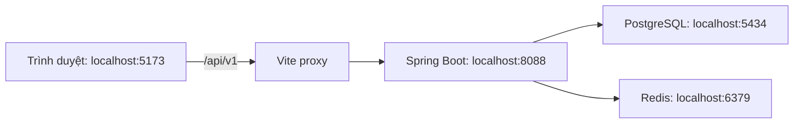
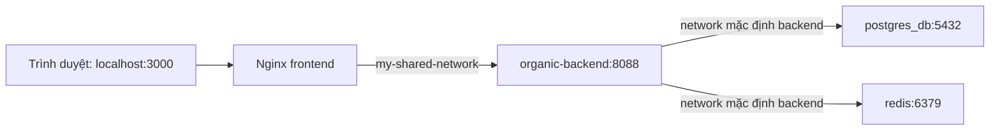

# Hướng dẫn cấu hình và chạy dự án Organic

**Dành cho:** thành viên mới và người trình bày trong buổi meeting bàn giao.  
**Môi trường hướng dẫn:** Windows, PowerShell, IntelliJ IDEA và Docker Desktop.  
**Ngày đối chiếu mã nguồn:** 19/10/2026.

Các đường dẫn bên dưới dùng `D:\oragnic-pro`. Nếu đồng nghiệp đặt dự án ở ổ đĩa/thư mục khác, thay phần đường dẫn này bằng vị trí thực tế.

## 1. Hiểu các thành phần trước khi chạy

```text
D:\oragnic-pro\
├── organic_backend\      Spring Boot, Java 21, Maven, API cổng 8088
└── organic_frontend\     React, Vite, Tailwind, Axios
```

| Thành phần | Vai trò | Cổng truy cập từ máy Windows |
| --- | --- | --- |
| Frontend chạy bằng Vite | Giao diện web khi phát triển | `5173` mặc định; xem URL Vite in ra |
| Frontend chạy bằng Docker/Nginx | Giao diện web từ bản build | `3000` mặc định |
| Spring Boot | Xử lý API, đăng nhập, nghiệp vụ | `8088` |
| PostgreSQL | Lưu dữ liệu | Host `5434` → container `5432` |
| Redis | Hỗ trợ xác thực/phiên và nghiệp vụ backend | Host `6379` → container `6379` |

**Mở giao diện ở cổng 5173 hoặc 3000.** Cổng 8088 là API; trang `/` của backend không phải trang chủ React và có thể trả 404.

### Hai cách chạy

| Nội dung | Cách A: phát triển trên máy | Cách B: toàn bộ bằng Docker |
| --- | --- | --- |
| PostgreSQL/Redis | Docker Compose backend hiện có | Docker Compose backend hiện có |
| Spring Boot | IntelliJ hoặc Maven Wrapper | Container `backend` bổ sung bằng file overlay |
| React | `pnpm.cmd dev` | Container frontend/Nginx |
| File cấu hình frontend | `.env.local` | `.env` hoặc file chỉ định bằng `--env-file` |
| Dockerfile backend | Không cần | Cần; có mẫu đi kèm |
| Network chung frontend/backend | Không cần | `my-shared-network` |
| Địa chỉ giao diện | `http://localhost:5173` | `http://localhost:3000` |

Chọn **một cách** để hướng dẫn trong lần chạy đầu. Với người mới, bắt đầu bằng Cách A để dễ đọc log và kiểm tra từng thành phần. Các mục Docker phía sau là một quy trình riêng.

## 2. Chuẩn bị máy — chỉ làm lần đầu

### 2.1. Phần mềm cần có

| Công cụ | Yêu cầu |
| --- | --- |
| Git | Để lấy/cập nhật mã nguồn của nhóm |
| JDK | Java 21; đặt Project SDK và Maven Runner JRE trong IntelliJ cùng dùng JDK 21 |
| Node.js | Theo `package.json`: từ 22.12.0 trở lên; Docker frontend dùng Node 22 |
| pnpm | `11.25.0`, khớp `packageManager` và lockfile dự án |
| Docker Desktop | Đang chạy, dùng Linux containers và Docker Compose v2 trở lên |
| IntelliJ IDEA | Mở và chạy backend Spring Boot |

Kiểm tra trong PowerShell:

```powershell
java -version
node --version
npm.cmd --version
pnpm.cmd --version
docker version
docker compose version
```

Không cần cài Maven toàn hệ thống nếu dùng `mvnw.cmd` trong backend.

### 2.2. Khi chưa có Node.js/pnpm

Nếu máy đã có `nvm` cho Windows nhưng chưa có Node.js, mở PowerShell với quyền quản trị khi phiên bản nvm đang dùng yêu cầu quyền tạo symlink, rồi chạy:

```powershell
nvm list
nvm install lts
nvm use lts
```

Đóng terminal, mở PowerShell mới và kiểm tra `node --version`, `npm.cmd --version`. Node được chọn phải thỏa điều kiện từ 22.12.0 trở lên.

Cài pnpm:

```powershell
npm.cmd install --global pnpm@11.25.0
pnpm.cmd --version
```

`nvm` quản lý phiên bản Node.js. `pnpm` quản lý thư viện và chạy script trong `package.json`. Vì vậy dùng `pnpm.cmd dev`, không dùng `nvm run dev`.

Hướng dẫn dùng đuôi `.cmd` để gọi trực tiếp lệnh Windows trong PowerShell. Nếu máy nhận `pnpm` bình thường, `pnpm dev` và `pnpm.cmd dev` có cùng mục đích.

### 2.3. Lấy đủ mã nguồn và cấu hình cá nhân

Đồng nghiệp cần cả hai thư mục backend và frontend, bao gồm Maven Wrapper, `pom.xml`, `package.json` và `pnpm-lock.yaml`. Cách lấy repository/branch thực hiện theo quy trình Git của nhóm; tài liệu này không giả định URL repository.

File `organic_backend/config/local.properties` đang bị Git bỏ qua. Người lấy mã mới phải tạo file này hoặc nhận cấu hình phát triển từ người phụ trách. Không gửi file chứa khóa thật lên repository.

## 3. Phân biệt các file môi trường

| File | Ai đọc? | Có bắt buộc không? |
| --- | --- | --- |
| Frontend `.env.example` | Người phát triển đọc để biết tên biến | Là mẫu, không tự chạy |
| Frontend `.env.local` | Vite khi chạy `dev`/build | Dùng cho Cách A |
| Frontend `.env` | Docker Compose mặc định; Vite cũng có thể đọc | Dùng trong quy trình Docker của tài liệu này |
| Backend `.env` | Docker Compose để thay biến `${...}` | Chỉ cần cho mẫu chạy Spring Boot bằng Docker |
| Backend `config/local.properties` | Spring Boot qua `spring.config.import` | Cần cấu hình JWT và các ghi đè cá nhân |

**Không cần tạo thêm frontend `.env` nếu chỉ chạy bằng `pnpm.cmd dev`.** Docker Compose không tự tìm `.env.local`; nếu muốn dùng tên file đó cho Compose, phải chỉ định `--env-file .env.local` và đặt đúng các biến dành cho Docker.

Nếu frontend có đồng thời `.env` và `.env.local`, Vite ưu tiên giá trị tương ứng trong `.env.local`. Biến đã đặt trong môi trường terminal có thể ghi đè giá trị trong file. Khởi động lại Vite sau khi sửa cấu hình môi trường.

### Ý nghĩa các biến frontend

| Biến | Ý nghĩa |
| --- | --- |
| `VITE_API_BASE_URL` | Tiền tố API mà trình duyệt sử dụng; giữ `/api/v1` trong hai cách chạy của tài liệu |
| `VITE_DEMO_MODE` | `false`: gọi backend thật; `true`: dữ liệu mẫu lưu ở trình duyệt |
| `DEV_API_TARGET` | Địa chỉ backend mà Vite proxy gọi khi chạy `dev` |
| `BACKEND_URL` | Địa chỉ backend mà Nginx gọi khi frontend chạy Docker |
| `FRONTEND_PORT` | Cổng publish frontend Docker, mặc định `3000` |

`VITE_*` là thông tin có thể xuất hiện trong trình duyệt. Chỉ đặt URL/cờ cấu hình, không đặt mật khẩu database, khóa JWT hoặc API key ở frontend.

## 4. Cách A — chạy PostgreSQL/Redis bằng Docker, Spring Boot bằng IntelliJ, React bằng Vite

### Bước A1. Mở Docker Desktop

Chờ Docker Desktop chạy xong. Kiểm tra:

```powershell
docker version
```

Kết quả phải kết nối được Docker Server, không chỉ hiện phiên bản Client.

### Bước A2. Khởi động PostgreSQL và Redis

Terminal 1:

```powershell
cd D:\oragnic-pro\organic_backend
docker compose up -d
docker compose ps
```

Compose backend hiện tại chỉ khai báo `postgres_db` và `redis`. Hai service phải ở trạng thái đang chạy. Nếu có lỗi:

```powershell
docker compose logs --tail 80 postgres_db redis
```

Kiểm tra `POSTGRES_USER`, `POSTGRES_PASSWORD`, `POSTGRES_DB` trong Compose backend đều có giá trị. Cấu hình Spring Boot phải khớp đúng database đang tồn tại.

Nếu volume PostgreSQL đã có dữ liệu, thay biến `POSTGRES_PASSWORD` trong Compose không tự đổi mật khẩu tài khoản trong database. Dùng thông tin đăng nhập đã khởi tạo hoặc thay mật khẩu bằng thao tác quản trị database phù hợp.

### Bước A3. Kiểm tra cấu hình backend

Backend đã đặt cổng `8088` và import tùy chọn `./config/local.properties` trong `src/main/resources/application.yml`. Các thông số cần khớp khi Spring Boot chạy trên Windows:

```properties
spring.datasource.url=jdbc:postgresql://localhost:5434/my_postgres_db
spring.datasource.username=admin
spring.datasource.password=REPLACE_WITH_EXISTING_POSTGRES_PASSWORD
spring.data.redis.host=localhost
spring.data.redis.port=6379
jwt.secret-key=REPLACE_WITH_VALID_LOCAL_JWT_SECRET
```

Đây là mẫu các khóa, không phải nội dung để ghi đè nguyên file đang dùng. Thay tên database/user nếu Compose của nhóm khác ví dụ; thay hai giá trị `REPLACE_...` bằng thông tin thật của môi trường phát triển.

**Cập nhật 20/10/2026:** `RedisConfig.java` đã ưu tiên `spring.data.redis.port` và hỗ trợ `spring.data.redis.post` cũ làm dự phòng. Cấu hình mới dùng `port` như ví dụ trên.

JWT backend hiện dùng HS512. Thành viên mới có thể nhận khóa phát triển của nhóm hoặc tạo khóa riêng cho máy local, tối thiểu 64 byte. Ví dụ tạo chuỗi ngẫu nhiên trong PowerShell:

```powershell
$jwtBytes = New-Object byte[] 64
$jwtGenerator = [System.Security.Cryptography.RandomNumberGenerator]::Create()
$jwtGenerator.GetBytes($jwtBytes)
[Convert]::ToBase64String($jwtBytes)
$jwtGenerator.Dispose()
```

Lưu chuỗi kết quả vào `jwt.secret-key` trong `config/local.properties`, giữ ổn định giữa các lần chạy. Không dùng nguyên chuỗi placeholder.

Nếu test đăng ký/OTP, cần cấu hình SendGrid hợp lệ, địa chỉ gửi và template tương ứng. Đăng nhập bằng tài khoản seed không cần đi qua bước đăng ký/OTP.

### Bước A4. Chạy Spring Boot

Trong IntelliJ:

1. Open thư mục `organic_backend` như Maven project, chờ đồng bộ dependency.
2. Chọn Project SDK và Maven Runner JRE là JDK 21.
3. Đặt working directory của Run Configuration là thư mục `organic_backend` để đọc đúng `./config/local.properties`.
4. Chạy class có annotation `@SpringBootApplication`.
5. Chờ log báo ứng dụng khởi động thành công tại cổng 8088.

Hoặc thay IntelliJ bằng Terminal 2:

```powershell
cd D:\oragnic-pro\organic_backend
.\mvnw.cmd spring-boot:run
```

Chọn một trong hai cách khởi động backend; không chạy cả IntelliJ lẫn Maven cùng lúc trên cổng 8088.

Kiểm tra API bằng trình duyệt:

```text
http://localhost:8088/api/v1/products?size=1
```

Hoặc terminal:

```powershell
curl.exe --noproxy "*" --fail --silent --show-error "http://127.0.0.1:8088/api/v1/products?size=1"
```

Kết quả đạt: phản hồi JSON có `statusCode: 200`, `name: PRODUCT_LIST`, dữ liệu nằm trong `data.items`. `items: []` nghĩa là API hoạt động nhưng database chưa có sản phẩm hiển thị.

### Bước A5. Cấu hình frontend gọi API thật

Terminal 3:

```powershell
cd D:\oragnic-pro\organic_frontend
```

Nếu chưa có `.env.local`, tạo một lần:

```powershell
Copy-Item .env.example .env.local
```

Nếu đã có file, sửa file hiện tại, không cần sao chép đè. Nội dung dùng cho Cách A:

```dotenv
VITE_API_BASE_URL=/api/v1
VITE_DEMO_MODE=false
DEV_API_TARGET=http://localhost:8088
```

Với máy dùng proxy doanh nghiệp/VPN hoặc gặp lỗi phân giải `localhost`, có thể thử `DEV_API_TARGET=http://127.0.0.1:8088`, sau đó khởi động lại Vite.

### Bước A6. Cài thư viện và chạy frontend

```powershell
pnpm.cmd install --frozen-lockfile
pnpm.cmd dev
```

Cài dependency ở lần đầu hoặc sau khi dependency/lockfile thay đổi. Các lần chạy bình thường chỉ cần `pnpm.cmd dev`.

Mở URL `Local` mà Vite in ra, mặc định:

```text
http://localhost:5173
```

Nếu cổng 5173 đang bận, Vite có thể chọn cổng kế tiếp. Dùng đúng URL được in trong terminal, không đoán cổng.

### Luồng gọi API của Cách A



Request trong DevTools có URL `http://localhost:5173/api/v1/...` là đúng: Vite chuyển tiếp sang cổng 8088. Hai server này dùng cổng khác nhau nhưng frontend gọi qua proxy cùng origin, nên luồng này không cần thêm CORS ở backend.

## 5. Dữ liệu và tài khoản test

Backend có `TestDataInitializer` và `CatalogDataInitializer`, được bật bằng `app.seed.enabled=true`/`APP_SEED_ENABLED=true`. Seed thêm bản ghi thiếu, không đặt lại mật khẩu tài khoản đã tồn tại.

| Vai trò | Tên đăng nhập backend | Mật khẩu seed |
| --- | --- | --- |
| Admin | `admin` | `Organic@123` |
| Khách hàng | `customer` | `Organic@123` |

Hai tài khoản trên đã được xác minh đăng nhập thành công trên backend local ngày 19/10/2026. Máy/database của đồng nghiệp có thể khác nếu họ đã tạo hoặc đổi mật khẩu cùng tên trước đó.

Các tài khoản `admin / Admin@123` và `khachhang / Khach@123` thuộc frontend demo, chỉ dùng khi `VITE_DEMO_MODE=true`. Khi chạy API thật, dùng tài khoản backend trong bảng trên.

Catalog seed tạo 5 danh mục và 8 sản phẩm, 16 biến thể. Database trên máy demo có thêm một danh mục do người dùng tạo: tại lần chụp dữ liệu có tổng cộng 6 danh mục và 8 sản phẩm. Không dùng số 6 như điều kiện bắt buộc cho máy mới.

| Sản phẩm seed | Giá từ |
| --- | ---: |
| Cải bó xôi hữu cơ | 32.000 đ |
| Cà rốt hữu cơ | 28.000 đ |
| Cà chua hữu cơ | 35.000 đ |
| Táo hữu cơ | 65.000 đ |
| Chuối hữu cơ | 25.000 đ |
| Gạo lứt hữu cơ | 45.000 đ |
| Yến mạch hữu cơ | 60.000 đ |
| Hạnh nhân hữu cơ | 95.000 đ |

Xem [hướng dẫn test](TEST_DATA.md) và [snapshot JSON](backend-test-data.json). Chứng nhận/ảnh placeholder trong seed là dữ liệu minh họa để phát triển.

## 6. Chứng minh frontend đang tương tác với backend

### 6.1. Kiểm tra đọc dữ liệu

1. Mở trang `/san-pham` trên frontend.
2. Nhấn F12, mở Network, chọn Fetch/XHR và tải lại trang.
3. Chọn request `products` hoặc `categories`.
4. Kiểm tra HTTP 200 và Response có cấu trúc `{ statusCode, name, message, data }`.
5. Đối chiếu tên/giá trên giao diện với `data.items`.

HTTP 200 nhưng không có sản phẩm cần kiểm tra trạng thái `active`, danh mục và dữ liệu database. HTTP 401/403 là lỗi xác thực/quyền, không đồng nghĩa frontend không gọi được backend.

### 6.2. Kiểm tra ghi dữ liệu và lưu sau tải lại

1. Đăng nhập Admin backend.
2. Vào `/admin/categories`, tạo mã mới `MEETING-CAT-001`, tên `Danh mục meeting`, trạng thái Hoạt động.
3. Xác nhận Network có `POST /api/v1/admin/categories`, HTTP 201.
4. Tải lại trang, tìm `MEETING-CAT-001`; danh mục vẫn được API trả về.
5. Sửa mô tả, xác nhận request PUT thành công và tải lại để đối chiếu.

Nếu đã tồn tại mã này, dùng hậu tố khác. Chỉ tạo dữ liệu mới cho buổi demo; không sửa sản phẩm nghiệp vụ của đồng nghiệp để minh họa.

### 6.3. Kiểm tra quyền và đăng xuất

1. Đăng xuất Admin bằng màn hình `/dang-xuat`.
2. Đăng nhập `customer / Organic@123`.
3. Vào `/admin/products`: frontend hiển thị trang không đủ quyền.
4. Đăng xuất; truy cập lại trang Admin phải chuyển về đăng nhập.

### 6.4. Giới hạn cần nói rõ trong meeting

- Chức năng giỏ hàng/yêu thích hiện lưu tại trình duyệt; chưa có API tạo đơn/thanh toán.
- Biểu mẫu sản phẩm API thật quản lý metadata, danh mục, thương hiệu và chứng nhận. Giá/ảnh thuộc API biến thể/ảnh riêng; chưa có trình biên tập biến thể/ảnh trong giao diện này.
- API hiện chưa cung cấp tồn kho/quy cách trên danh sách sản phẩm. Không lấy số tồn kho demo làm tồn kho database.
- Đăng ký cần SendGrid và OTP; tài khoản seed hỗ trợ demo đăng nhập khi email chưa được cấu hình.
- Phiên hết hạn yêu cầu đăng nhập lại; frontend chưa tự làm mới access token.

## 7. Cách B — chạy toàn bộ bằng Docker

Phần này dành cho người muốn cả Spring Boot và React chạy trong container. Compose backend gốc hiện chưa có service ứng dụng Spring Boot; chỉ thêm network cho PostgreSQL/Redis không tạo ra container backend.

### Bước B1. Dừng ứng dụng Spring Boot đang chạy trên máy

Stop ứng dụng trong IntelliJ hoặc Ctrl+C tại terminal Maven để giải phóng cổng 8088. Có thể dừng Vite nếu không dùng nữa. Giữ Docker Desktop hoạt động.

### Bước B2. Chuẩn bị file Docker backend

Các mẫu nằm trong `organic_frontend/docs/examples/backend/`. Chúng chưa được chép tự động vào dự án backend.

Nếu backend chưa có các file tương ứng, chép vào thư mục backend:

```powershell
cd D:\oragnic-pro\organic_backend
Copy-Item ..\organic_frontend\docs\examples\backend\Dockerfile .\Dockerfile
Copy-Item ..\organic_frontend\docs\examples\backend\compose.app.yml .\compose.app.yml
Copy-Item ..\organic_frontend\docs\examples\backend\.dockerignore .\.dockerignore
```

Nếu nhóm đã có Dockerfile hoặc `.dockerignore`, đối chiếu trước khi thay file. Mẫu Dockerfile dùng Maven/Java 21 để build và JRE 21 để chạy JAR.

`compose.app.yml` là **file overlay**, được gộp với `docker-compose.yml` backend hiện có. Nó thêm healthcheck cho database/Redis và thêm service `backend`, giữ nguyên khai báo database, mật khẩu và volumes trong file gốc. Không chạy overlay một mình.

### Bước B3. Cấu hình môi trường backend Docker

Nếu backend chưa có `.env`, tạo từ mẫu:

```powershell
Copy-Item ..\organic_frontend\docs\examples\backend\.env.example .\.env
```

Sửa backend `.env`:

```dotenv
BACKEND_DB_NAME=my_postgres_db
BACKEND_DB_USER=admin
BACKEND_DB_PASSWORD=REPLACE_WITH_EXISTING_POSTGRES_PASSWORD
APP_SEED_ENABLED=true
```

Ba giá trị database phải khớp PostgreSQL đã khởi tạo trong Compose gốc. Không giữ nguyên placeholder mật khẩu.

Đảm bảo `config/local.properties` tồn tại, có `jwt.secret-key` hợp lệ. Overlay mount file này read-only vào `/app/config/local.properties`; nếu file không tồn tại, cần tạo trước khi khởi động container.

Nếu backend `.gitignore` chưa có, bổ sung `.env` để file cấu hình cá nhân không bị commit. Backend hiện đã bỏ qua `config/local.properties`.

### Bước B4. Tạo network chung nếu chưa tồn tại

```powershell
docker network ls
docker network inspect my-shared-network
```

Nếu inspect báo không tìm thấy mạng:

```powershell
docker network create my-shared-network
```

Chỉ tạo một lần trên Docker Engine đang dùng. Đây là network ảo trong Docker, không phải file/thư mục của repository. Tên chính xác là **`my-shared-network`**.

### Hai vị trí khai báo network và vì sao cần cả hai

Đây là phần đã có sẵn trong overlay:

```yaml
services:
  backend:
    # build/environment/volumes nằm ở các phần khác của service
    networks:
      default: {}
      shared:
        aliases:
          - organic-backend

networks:
  default: {}
  shared:
    external: true
    name: my-shared-network
```

| Vị trí | Ý nghĩa |
| --- | --- |
| `networks` ở cấp gốc | Khai báo mạng Compose sử dụng; `shared` là tên tham chiếu nội bộ, `my-shared-network` là tên mạng thật trong Docker |
| `services.backend.networks` | Chọn các mạng container Spring Boot tham gia |
| `aliases: organic-backend` | Tên để Nginx frontend gọi đúng container Spring Boot trên mạng chung |
| `default` của backend | Cho Spring Boot kết nối PostgreSQL/Redis cùng Compose backend |
| `external: true` | Compose sử dụng mạng đã tồn tại, không tự tạo/xóa mạng này |

PostgreSQL/Redis tiếp tục nằm ở network mặc định của Compose backend. Chỉ container ứng dụng Spring Boot cần tham gia thêm mạng chung với frontend.

### Bước B5. Build và chạy backend Docker

```powershell
cd D:\oragnic-pro\organic_backend
docker compose --env-file .env -f docker-compose.yml -f compose.app.yml config --quiet
docker compose --env-file .env -f docker-compose.yml -f compose.app.yml up -d --build
docker compose --env-file .env -f docker-compose.yml -f compose.app.yml ps
docker compose --env-file .env -f docker-compose.yml -f compose.app.yml logs -f backend
```

Database/Redis phải healthy trước khi service backend khởi động. Chờ log Spring Boot thành công, kiểm tra API ở `http://localhost:8088/api/v1/products?size=1`.

Nhấn Ctrl+C để thoát phần xem log `logs -f`; thao tác này không dừng container đang chạy nền.

Địa chỉ được dùng bên trong container:

| Kết nối | Địa chỉ đúng |
| --- | --- |
| Spring Boot → PostgreSQL | `postgres_db:5432` |
| Spring Boot → Redis | `redis:6379` |
| Nginx frontend → Spring Boot | `organic-backend:8088` |

`localhost` bên trong container là chính container đó. Vì thế không dùng `localhost:5434` để Spring Boot trong Docker gọi database. Overlay đã ghi đè các thông số phù hợp bằng environment.

### Bước B6. Cấu hình frontend Docker

Trong thư mục frontend, nếu chưa có `.env`:

```powershell
cd D:\oragnic-pro\organic_frontend
Copy-Item .\docs\examples\frontend.docker.env.example .\.env
```

Nếu đã có, sửa file hiện tại. Nội dung dùng cho hai ứng dụng cùng Docker:

```dotenv
FRONTEND_PORT=3000
VITE_API_BASE_URL=/api/v1
VITE_DEMO_MODE=false
BACKEND_URL=http://organic-backend:8088
```

Không đặt `VITE_API_BASE_URL=http://organic-backend:8088`: tên này phục vụ kết nối trong Docker, không dành cho trình duyệt Windows.

### Bước B7. Build và chạy frontend Docker

```powershell
cd D:\oragnic-pro\organic_frontend
docker compose --env-file .env config --quiet
docker compose --env-file .env up -d --build
docker compose --env-file .env ps
```

Mở `http://localhost:3000`. Kiểm tra `http://localhost:3000/health` phải trả `ok`, sau đó kiểm tra request sản phẩm ở Network.

Frontend Dockerfile build React thành `dist/`, rồi Nginx phục vụ file tĩnh và chuyển tiếp API. `runtime-config.js` được tạo lại khi container khởi động; ứng dụng ưu tiên cấu hình runtime này trước giá trị đã build.

Nếu chỉ đổi environment Docker, dùng `docker compose --env-file .env up -d --force-recreate`. Nếu sửa mã nguồn frontend, dùng `docker compose --env-file .env up -d --build`.

### Luồng gọi API của Cách B



Hai Compose được khởi động độc lập: chạy backend trước, kiểm tra API, rồi chạy frontend. Healthcheck frontend chỉ xác nhận Nginx đang phục vụ; vẫn cần kiểm tra request API để xác nhận backend hoạt động.

## 8. Trường hợp bổ sung: frontend Docker, backend IntelliJ

Trên Docker Desktop cho Windows, nếu muốn frontend Docker gọi Spring Boot chạy trên máy host, đặt frontend `.env`:

```dotenv
FRONTEND_PORT=3000
VITE_API_BASE_URL=/api/v1
VITE_DEMO_MODE=false
BACKEND_URL=http://host.docker.internal:8088
```

Giữ PostgreSQL/Redis và backend IntelliJ như Cách A, rồi chạy Compose frontend. Network `my-shared-network` vẫn phải tồn tại vì Compose frontend hiện có khai báo external network đó; Spring Boot trên host không tham gia network Docker. Trường hợp này không cần Dockerfile/service Spring Boot.

## 9. Chạy lại và dừng dự án hằng ngày

### Cách A — chạy lại

1. Mở Docker Desktop.
2. Trong backend: `docker compose up -d`.
3. Run Spring Boot bằng IntelliJ hoặc `mvnw.cmd`.
4. Trong frontend: `pnpm.cmd dev`.
5. Mở URL Vite in ra và đăng nhập tài khoản backend.

### Cách A — dừng

1. Ctrl+C tại terminal Vite.
2. Stop Spring Boot trong IntelliJ hoặc Ctrl+C tại terminal Maven.
3. Nếu muốn dừng database/Redis, chạy `docker compose stop` trong thư mục backend.

### Cách B — chạy lại sau khi đã cấu hình

Backend:

```powershell
cd D:\oragnic-pro\organic_backend
docker compose --env-file .env -f docker-compose.yml -f compose.app.yml up -d
```

Frontend:

```powershell
cd D:\oragnic-pro\organic_frontend
docker compose --env-file .env up -d
```

Khi mã nguồn thay đổi, thêm `--build` ở service cần build lại.

### Cách B — dừng

Frontend:

```powershell
cd D:\oragnic-pro\organic_frontend
docker compose --env-file .env stop
```

Backend:

```powershell
cd D:\oragnic-pro\organic_backend
docker compose --env-file .env -f docker-compose.yml -f compose.app.yml stop
```

`stop` giữ container và volumes. `down` gỡ container/network do Compose quản lý nhưng giữ named volumes theo mặc định. Không dùng `down -v` trong buổi demo hoặc quy trình dừng hằng ngày vì cờ `-v` xóa volumes dữ liệu.

## 10. Xử lý lỗi thường gặp

| Hiện tượng | Kiểm tra và cách xử lý |
| --- | --- |
| `pnpm is not recognized` | Kiểm tra Node/npm; cài `npm.cmd install --global pnpm@11.25.0`, mở terminal mới, thử `pnpm.cmd --version` |
| `nvm run dev` chỉ hiện Usage | Dùng `nvm use ...` để chọn Node, sau đó chạy `pnpm.cmd dev` trong frontend |
| PowerShell chặn file `npm.ps1`/`pnpm.ps1` | Gọi `npm.cmd`/`pnpm.cmd` như trong hướng dẫn |
| Docker báo không kết nối daemon | Mở Docker Desktop, chờ Docker Server sẵn sàng |
| Compose cảnh báo `version is obsolete` | Đây là cảnh báo với dòng `version: '3.8'` trong file cũ; Compose hiện tại vẫn đọc file. Nhóm có thể bỏ riêng dòng `version` khi cập nhật cấu hình. |
| Backend lỗi Java/Maven | Kiểm tra JDK 21 trong terminal, Project SDK và Maven Runner JRE |
| Không tìm thấy `jwt.secret-key` | Tạo/kiểm tra `config/local.properties`, kiểm tra working directory là thư mục backend |
| Sai mật khẩu PostgreSQL | Đối chiếu database thực tế; biến mới trong Compose không đặt lại mật khẩu volume cũ |
| Spring Boot Docker gọi DB bị từ chối | Dùng `postgres_db:5432`, không dùng `localhost:5434` |
| Backend lỗi Redis | Kiểm tra service Redis và khóa `spring.data.redis.port`; backend mới vẫn hỗ trợ khóa `post` cũ |
| Cổng 8088 bị chiếm | Không chạy đồng thời Spring Boot IntelliJ và container backend trên cùng cổng |
| UI có sản phẩm nhưng không thấy request API | Kiểm tra `VITE_DEMO_MODE=false`; restart Vite hoặc recreate container |
| Đổi `.env.local` chưa có hiệu lực | Dừng/chạy lại Vite; kiểm tra không bị biến môi trường terminal ghi đè |
| Thay `DEV_API_TARGET` nhưng vẫn gọi địa chỉ cũ | Dùng cấu hình Vite đã có `loadEnv`; restart dev server |
| Network báo HTTP 401 | Kiểm tra tài khoản/mật khẩu backend, đăng nhập lại khi phiên hết hạn |
| HTTP 403 tại API Admin | Dùng tài khoản có role ADMIN |
| Trùng mã danh mục/sản phẩm | Chọn mã mới; không gửi lại cùng mã khi thử tạo lần tiếp theo |
| Chọn `verified` nhưng lưu sản phẩm lỗi | Chọn chứng nhận verified còn hiệu lực hoặc để trạng thái Đang xác minh khi tạo sản phẩm test |
| Frontend Docker trả 502 cho API | Kiểm tra backend chạy, cùng network, alias `organic-backend`, cổng 8088 và `BACKEND_URL` |
| `network my-shared-network declared as external, but could not be found` | Tạo network đúng tên bằng `docker network create my-shared-network` |
| Docker backend báo thiếu file mount | Tạo `organic_backend/config/local.properties` trước khi khởi động |
| Giao diện `/` tại cổng 8088 báo 404 | Mở frontend tại cổng 5173 hoặc 3000; kiểm tra backend qua `/api/v1/products` |
| Sản phẩm mới hiện giá Liên hệ | Chưa có biến thể giá; biểu mẫu hiện chỉ quản lý metadata sản phẩm |
| Đăng ký không nhận OTP | Kiểm tra SendGrid/sender/template và log backend; dùng tài khoản seed để demo chức năng khác |
| Frontend có ảnh placeholder | Catalog seed dùng ảnh minh họa; không phải lỗi kết nối API |

Một số lệnh chẩn đoán:

```powershell
Get-Command node,npm.cmd,pnpm.cmd,docker -ErrorAction SilentlyContinue
Get-NetTCPConnection -State Listen -LocalPort 5173,8088,5434,6379 -ErrorAction SilentlyContinue
docker network inspect my-shared-network
```

Không chia sẻ ảnh/log chứa access token, mật khẩu hoặc nội dung file khóa khi trao đổi lỗi. Chỉ cần status HTTP, thông báo lỗi và URL endpoint để bắt đầu kiểm tra.

## 11. Checklist bàn giao trước meeting

- [ ] Chọn rõ Cách A hoặc Cách B để demo trực tiếp.
- [ ] Docker Desktop đang hoạt động; database/Redis đã chạy.
- [ ] Dependency Maven và pnpm đã tải xong trước meeting.
- [ ] Backend khởi động thành công, API public trả HTTP 200.
- [ ] Frontend dùng `VITE_DEMO_MODE=false`.
- [ ] Đăng nhập được Admin/Customer backend.
- [ ] Có dữ liệu seed hoặc dữ liệu test do nhóm chuẩn bị.
- [ ] Chuẩn bị mã danh mục/sản phẩm chưa trùng để tạo mới trong demo.
- [ ] Mở sẵn DevTools Network để chỉ ra request GET/POST/PUT.
- [ ] Nói rõ giới hạn biến thể/giá/ảnh, tồn kho, giỏ hàng và OTP.
- [ ] Đồng nghiệp biết vị trí file môi trường cá nhân và các file không theo Git.
- [ ] Đồng nghiệp nắm cách dừng/chạy lại mà không xóa volume.

## 12. Tài liệu và phạm vi xác minh

- [Kịch bản meeting 30 phút](KICH_BAN_MEETING.md).
- [Dữ liệu và tình huống test](TEST_DATA.md).
- [Kết quả kiểm tra frontend trước đó](VERIFICATION.md).
- [Mẫu backend Dockerfile](examples/backend/Dockerfile).
- [Mẫu overlay thêm Spring Boot vào Compose backend](examples/backend/compose.app.yml).
- [Mẫu environment frontend Docker](examples/frontend.docker.env.example).

Tài liệu được đối chiếu với source/config tại ngày ghi ở đầu. Quy trình Cách A và các tài khoản test đã được kiểm tra với backend local. Mẫu backend Docker là cấu hình bàn giao bổ sung; kiểm tra cấu hình Compose không thay thế việc build/chạy thử toàn bộ backend Docker trên máy của nhóm. PostgreSQL và Redis vẫn giữ nguyên service/volume trong Compose gốc.

Tham khảo chính thức: [Vite: loadEnv trong cấu hình](https://vite.dev/config/#using-environment-variables-in-config), [Docker Compose: biến môi trường và --env-file](https://docs.docker.com/compose/how-tos/environment-variables/variable-interpolation/), [Docker Compose: networking](https://docs.docker.com/compose/how-tos/networking/), [Spring Boot: cấu hình bên ngoài](https://docs.spring.io/spring-boot/reference/features/external-config.html).
